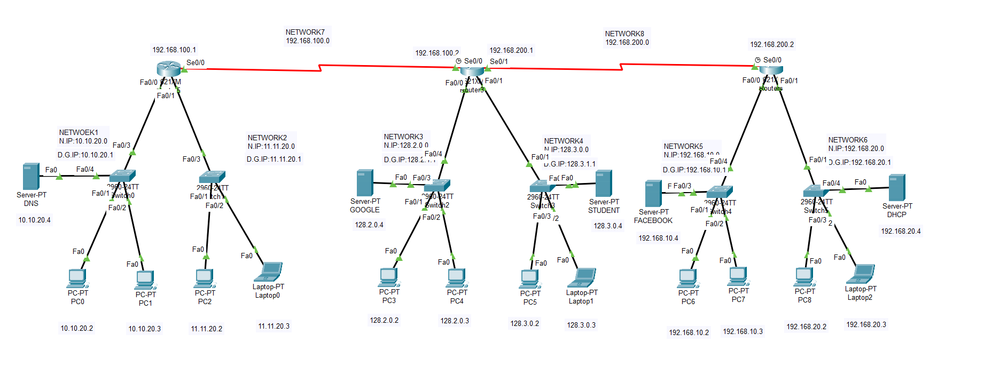

# تصميم ومحاكاة شبكة متكاملة — Cisco Packet Tracer Topology

مشروع محاكاة شبكة حاسوبية مبني باستخدام **Cisco Packet Tracer** يضم عدة شبكات فرعية، رواترات، سويتشات، أجهزة طرفية (`PC` / `Laptop`)، وخوادم خدمات (`DNS`، `DHCP`، وخدمات ويب/طلاب).

## لقطة طوبولوجيا الشبكة

## أبرز مكونات وعناصر الشبكة
* **الربط بين الشبكات:** رواترات وروابط تسلسلية/إيثرنت لربط الشبكات الفرعية المختلفة.
* **الشبكات الفرعية وعناوين IP:** نطاقات متعددة (مثل `10.10.20.0`، `11.11.20.0`، `128.2.0.0`، `128.3.0.0`، `192.168.10.0`، `192.168.20.0`، وروابط `192.168.100.0` / `192.168.200.0`).
* **الخوادم والخدمات:** خوادم للـ `DNS` والـ `DHCP` وخوادم خدمات (`GOOGLE`، `FACEBOOK`، `STUDENT`) مع أجهزة عملاء لاختبار الاتصال.

## طريقة التشغيل
1. تأكد من تثبيت برنامج **Cisco Packet Tracer** على جهازك.
2. قم بتحميل ملف الشبكة (`.pkt`) من المستودع.
3. افتح الملف مباشرة داخل **Cisco Packet Tracer** لاستعراض التصميم، فحص إعدادات العناوين والتوجيه، واختبار الاتصال في وضعي `Realtime` و`Simulation`.
٤.
